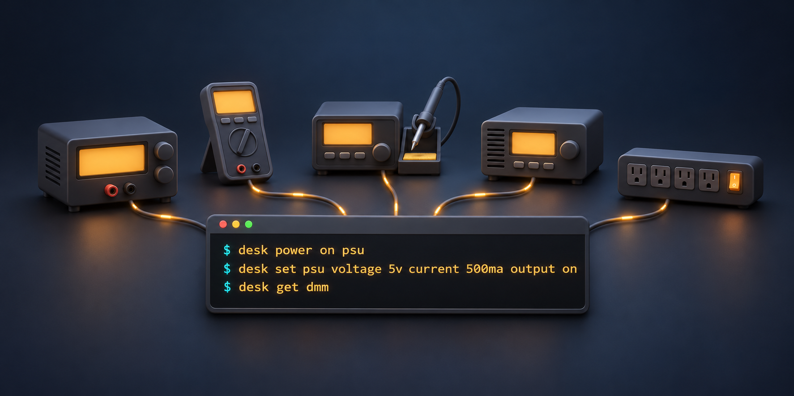

### Desk Operator - One CLI for your whole electronics bench



[](https://github.com/robin7331/desk-operator/actions/workflows/ci.yml)
[](https://github.com/robin7331/desk-operator/releases/latest)
[](https://github.com/robin7331/desk-operator/releases)
[](#install)
[](https://rustup.rs)
[](#license)
[](https://github.com/robin7331/desk-operator/commits/main)
[](https://github.com/robin7331/desk-operator/stargazers)

One interface for the equipment on an electronics bench: power supplies, multimeters, DC loads,
soldering irons and switched mains outlets. `desk` is a single command-line tool, and every command
also works for scripts and agents with `--json`.

```sh
desk power on psu
desk set psu voltage 5v current 500ma output on
desk get dmm
desk watch dmm
```

## Install

Linux and macOS:

```sh
curl -fsSL https://raw.githubusercontent.com/robin7331/desk-operator/main/install.sh | sh
```

Windows (PowerShell):

```powershell
irm https://raw.githubusercontent.com/robin7331/desk-operator/main/install.ps1 | iex
```

Both verify the download and offer to install the agent skills. To update later, run
`desk update` (`desk update --check` only looks), or the install command again.

To build from source instead, you
need [Rust](https://rustup.rs) (stable):

```sh
git clone https://github.com/robin7331/desk-operator
cd desk-operator
cargo install --path .
```

Models are compiled into `desk`, so a new device arrives with the next build.

## Let an agent set up your bench

`desk` ships with agent skills, so your coding agent can guide you through bringing in your devices.
Install them once (the install command above offers this too):

```sh
desk skill install --global   # Claude Code; for another agent: --dir <its skills folder>
```

Then tell your agent what's on your bench, for example:

> Set up my bench with desk. I have a FNIRSI IPS3608 and a multimeter that may not be supported yet.
> Ask me what you need.

- **A supported device:** the agent adds it to your `desk.toml` and asks for your limits.
- **A device desk doesn't know yet:** the agent researches its protocol, writes and tests a driver
  against a fake device, smoke-tests it with you, and can open a pull request to share it.
- **Your hardware stays in your hands:** the skills tell the agent to change things only when you
  ask, and to wait for your OK before each step that switches something while adding a device.

## Set up your bench by hand

Your devices go in `desk.toml`. `desk schema --json` shows where it's expected (`data.config.path`),
and [`examples/desk.toml`](examples/desk.toml) is a sample that runs without any hardware:

```sh
desk --config examples/desk.toml power status
```

A device from the list below only needs its model, plus anything specific to your bench:

```toml
[devices.dmm]
model = "owon/xdm1041"
power = { provider = "ha", entity = "switch.desk_outlet_1" }   # optional: how it gets mains power
```

`desk device show <device>` lists what a device can do, and leaving out arguments
(`desk set <device>`) lists the options. `desk completions <shell>` adds Tab completion.

## Supported devices

| Device | Type | Status |
|---|---|---|
| [FNIRSI DPS-150](models/fnirsi/README.md) | Power supply | community |
| [FNIRSI IPS3608](models/fnirsi/README.md) | Power supply | tested |
| [OWON OEL1515](models/owon/README.md) | DC load | community |
| [OWON XDM1041](models/owon/README.md) | Multimeter | community |

`tested`: smoke-tested on real hardware. `community`: not fully verified on hardware, see the vendor
README. `desk model list` shows what your build includes.

> [!WARNING]
> **Use at your own risk.** Device models and drivers may be community-provided, and even `tested`
> only means a smoke test on one unit. `desk` switches real mains power, outputs and heaters, so a
> bug or a wrong setting can damage your equipment or whatever is connected to it. Set your own
> `limits`, try new devices with nothing connected, and check the results. desk comes without any
> warranty (see [License](#license)).

## Add a device

```sh
desk model new acme/psu-3000 --capability voltage_source --name "ACME PSU 3000" \
    --max-voltage 30 --max-current 5
```

This creates a working folder next to your `desk.toml`, and desk uses it right away. To contribute
it, see [`models/README.md`](models/README.md). An agent can walk you through all of it:
`desk skill install` installs the `desk-add-device` skill.

## License

Licensed under either of [Apache License 2.0](LICENSE-APACHE) or [MIT license](LICENSE-MIT), at your
option. You can use desk for anything, also commercially.

Unless you state otherwise, any contribution you submit for inclusion in this project is licensed
under the same two licenses, without any additional terms or conditions.
